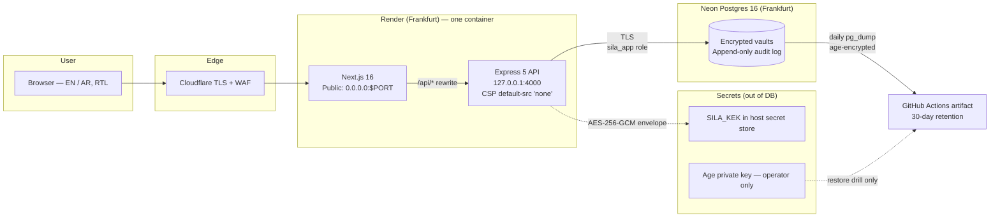
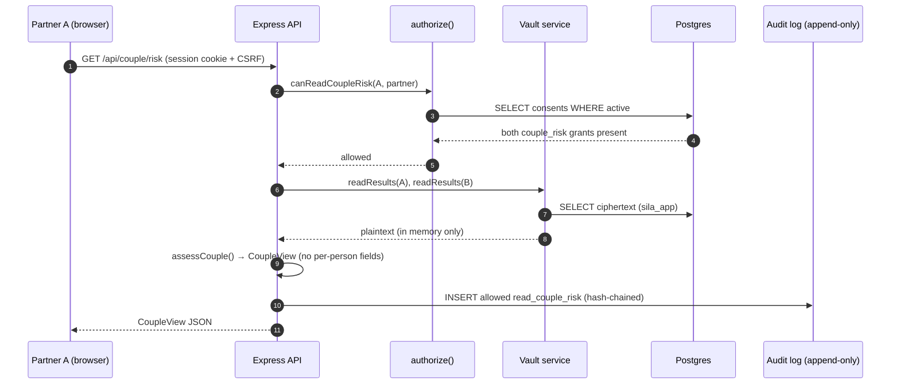

# Sila (صلة)

**A privacy-first carrier-screening pilot for couples.**

Each person holds their own result in an encrypted vault. A couple only sees the combined risk when both partners have given consent, and either can revoke at any time. Results are explained in plain English and Arabic; high-risk or unclear cases are routed to a qualified genetic counsellor with a traceable referral path.

Built by **CEDELA Tech Park Solutions** for the **Future Health Digital Innovation Challenge**, Challenge 03 — *Understanding and Reducing Inherited Disease Risk*.

**Live pilot:** https://sila-a7fx.onrender.com   ·   **Latest tag:** `v1.1.1-pilot`
**Submission status:** prototype using synthetic data only · not medical advice.

---

## What Sila does

| Challenge requirement | How Sila meets it |
| --- | --- |
| **Explain genetic risk clearly** | Plain-language result screens that distinguish carrier vs affected, risk vs diagnosis, couple risk per pregnancy, and uncertainty. Every sentence comes from fixed templates — *no AI model generates clinical text*. |
| **Support informed, values-sensitive choices** | A neutral options page lists possibilities without ranking or recommending; the UI never pushes a reproductive or marriage decision. |
| **Route to qualified counsellors** | A referral tracker with a seven-step timeline and a counsellor queue that only shows cases where the person currently grants access. |
| **Preserve privacy at family level** | Per-person encrypted vaults (AES-256-GCM, envelope-wrapped keys), per-use consent, revocable at any time, immediate effect. The couple view never reveals which partner carries what. |
| **Link safely to services** | Counsellor booking, confirmatory test, specialist referral and closure — each step timestamped and auditable. |
| **Measure comprehension and access** | Before/after comprehension quizzes for volunteers; evaluator dashboard with per-language and per-reading-band aggregates (minimum n ≥ 5, no totals). |

Scope cut: carrier screening for the sickle cell / HbC / β-thalassaemia family (HBB), cystic fibrosis (CFTR) and inherited hearing loss (GJB2). Panel is a clinical decision — not a developer one.

---

## System architecture



**Trust zones.**
- The Express API is bound to `127.0.0.1` inside the container and is only reached via Next.js's `/api/*` rewrite. It has no public listener.
- `sila_app` is a least-privilege role with `SELECT + INSERT` on `audit_log` and CRUD on data tables. The migration runner (`sila_owner`) is used only by GitHub Actions deploys; its URL lives in a repo secret, not on Render.
- Encryption keys (`SILA_KEK`) live in the Render secret store, never in the database. Backup encryption uses `age`; the private key is held outside Render + Neon + GitHub, in the operator's password manager.

### Request lifecycle (couple risk)



Any missing or revoked consent returns **403 immediately** and writes a denied audit row. Policy is checked **fresh on every request** — revocation takes effect at once.

### Role separation on the signed-in app

```mermaid
flowchart TB
    L["/login<br/>(one login page for everyone)"]
    L --> P[person → /home]
    L --> C[counsellor → /counsellor-queue]
    L --> B[lab → /lab]
    L --> E[evaluator → /evaluator]
    L --> AD[admin → /admin]

    P -. "person-only routes" .-> PR[/api/me · /api/consent · /api/couple · /api/partner · /api/relatives · /api/referrals/]
    C -. counsellor-only .-> CR[/api/counsellor/*]
    B -. lab-only .-> LR[/api/lab/submit — write only, no read-back]
    E -. evaluator-only .-> ER[/api/evaluator/* — aggregates, n ≥ 5]
    AD -. admin-only .-> ADR[/api/admin/* — staff + invites + audit feed]

    classDef deny fill:#fde,stroke:#a33,color:#6a1;
    classDef role fill:#e8f5ee,stroke:#0e7854,color:#0e7854;
    class P,C,B,E,AD role
```

Cross-role attempts return `403` and write a `person_endpoint_access | denied` (or admin/lab equivalent) row to the audit log. Each role is proven in isolation by `attack/cases/role_scope.ts` and `attack/cases/admin_lab.ts`.

---

## Security + privacy guarantees (verified on live)

| Guarantee | Enforcement | Verification |
| --- | --- | --- |
| Person holds the key to their own data | Per-person data key wrapped under `SILA_KEK`; deleting the wrapped key crypto-shreds the vault | `server/src/test/vault.test.ts` |
| Couple view only exists while both consents are active | Fresh policy check per request | `server/src/test/coupleRisk.test.ts` + attack suite revocation checks |
| Couple view carries no per-person field | `CoupleView` type has no per-person keys; reasons collapsed to couple labels | `server/src/test/coupleRisk.test.ts` |
| Admin never reads person data | `requirePersonRole` + `requireLabRole` + explicit allow-list per route | `attack/cases/admin_lab.ts` (ADMIN hits 403 on 8 person routes) |
| Lab never reads a result back | There is no GET in `/api/lab/*` | `attack/cases/admin_lab.ts` (LAB hits 403 on 4 person routes) |
| Rate-limit survives Cloudflare / XFF spoofing | `trust proxy = 3` matches real hop chain | `attack/cases/brute_force.ts` XFF-spoof |
| Staff cannot log in without TOTP enrolled | Fail-closed in `/api/auth/login` | `server/src/test/auth.test.ts` (totp_not_enrolled) |
| Audit log cannot be modified | Append-only DB trigger + SHA-256 hash chain | `npm run audit:verify` |
| No real genetic data ever | Synthetic generator with fixed seed | `scripts/generate-synthetic.ts`; CLAUDE.md rule |
| No AI in the risk calculation or clinical text | Mendelian engine + template catalog | `src/lib/genetics/engine.ts`; `src/content/templates/` |

Latest live run: **attack suite 37/37 passed**, **axe a11y 26 scans / 0 serious**, **audit log clean**. See [docs/evaluation-results.md](docs/evaluation-results.md).

---

## Tech stack

- **Frontend.** Next.js 16 (App Router), React 19, Tailwind v4. Bilingual EN/AR with RTL; WCAG 2.2 AA. CSP `default-src 'self'` with `'unsafe-inline'` limited to scripts/styles.
- **API.** Express 5 + TypeScript, zod on every body, helmet for headers. CSP `default-src 'none'` on JSON responses. Argon2id password hashing at OWASP ASVS minimum, with rehash-on-login.
- **Database.** PostgreSQL 16 (Neon in prod, PGLite for local in-process tests, Docker Postgres for CI). Drizzle ORM + drizzle-kit migrations.
- **Encryption.** AES-256-GCM envelope — per-person data key wrapped under a KEK, AAD binds `person:<id>|record:<id>|v<version>`. KEK rotation via `npm run kek:rotate`.
- **Tests.** Vitest (unit + integration, 200+ tests), Playwright (end-to-end + axe a11y), a black-box attack suite (37 cases), a privacy-report Vitest reporter.
- **Hosting.** Render (Frankfurt, free Docker) fronted by Cloudflare. Neon Postgres (Frankfurt). Daily encrypted backup to a GitHub Actions artifact (`age` + `pg_dump`), 30-day retention.

---

## Repository layout

```
.
├─ src/                      Next.js app (public landing + signed-in pages)
│  ├─ app/
│  │  ├─ (app)/             Signed-in shell + dashboards
│  │  ├─ (auth)/            Login / signup
│  │  ├─ (volunteer)/       Volunteer study flow
│  │  ├─ docs/[slug]/       In-app rendered markdown docs
│  │  └─ invite/[code]/     Staff invite claim wizard
│  ├─ content/templates/    Clinical templates (EN + AR, status-tracked)
│  └─ lib/genetics/         Mendelian engine, panel, synthetic generator
├─ server/src/              Express API
│  ├─ routes/               /auth, /me, /couple, /consent, /partner, /relatives,
│  │                        /referrals, /counsellor, /lab, /admin, /invite, /evaluator, /demo
│  ├─ middleware/           requireSession, requireCsrf, require<Person|Admin|Lab>Role
│  ├─ services/             vault, consent, coupleRisk, invite, …
│  ├─ lib/                  totp, silaId, audit, policy, crypto, …
│  └─ db/                   Drizzle schema + client
├─ attack/                  Black-box attack suite (npm run attack)
├─ scripts/                 seed, admin:create, kek:rotate, screenshots, …
├─ drizzle/                 SQL migrations
├─ tests/e2e/               Playwright specs
└─ docs/                    data-governance, threat-model, security-controls,
                            evaluation-results, pilot-path, demo-script, …
```

---

## Run it locally

```bash
docker compose up -d postgres
cp .env.example .env         # DATABASE_URL (sila_app), DATABASE_ADMIN_URL (sila_owner),
                             # SILA_KEK, SESSION_SECRET, VOLUNTEER_HMAC_KEY,
                             # DEMO_PASSWORD, EVALUATOR_PASSWORD,
                             # DEMO_MODE (true for the pilot host; false in production)
npm install
npm run db:migrate
psql "$DATABASE_ADMIN_URL" -f scripts/sql/grant-app.sql
DEMO_PASSWORD=... EVALUATOR_PASSWORD=... npm run seed
npm run server:dev           # API on :4000
npm run dev                  # Next.js on :3000
# open http://localhost:3000
```

### Bootstrap the first admin (no default admin exists)

```bash
npm run admin:create -- --email you@example.com --name "Your Name"
# prints a one-time URL — open it in the browser to set a password + enrol TOTP.
```

### Tests, build and attack suite

```bash
npm run lint
npm run typecheck
npm test                              # ~200 tests, PGLite locally
npm run build
BASE_URL=http://localhost:3000 SILA_EXPECT_DEMO_MODE=true npm run attack
BASE_URL=http://localhost:3000 npx playwright test
BASE_URL=http://localhost:3000 npm run screenshots
npm run audit:verify                  # verifies the hash-chain on the audit log
```

---

## Deployment

Every push to `main` runs CI (lint + typecheck + 200 tests on real Postgres + `docker build` + gitleaks secret-scan). Deployment is manual (`workflow_dispatch`) or tag-triggered (`v*`); the deploy workflow refuses to run if any CI job on the same SHA is not green, then runs migrations as `sila_owner` and posts the Render deploy hook.

Restore drill lives in `.github/workflows/restore-drill.yml` — operator adds two short-lived GitHub secrets (`RESTORE_AGE_KEY`, `RESTORE_BRANCH_URL`) to a disposable Neon branch, runs the workflow, compares row counts live vs restored, and deletes the secrets + branch afterwards. The age private key is never a workflow_dispatch input.

See [docs/deploy-runbook.md](docs/deploy-runbook.md) for the full runbook.

---

## Documentation

- [docs/data-governance.md](docs/data-governance.md) — what Sila collects, the consent model, retention, what Sila will **never** do with genetic data.
- [docs/threat-model.md](docs/threat-model.md) — STRIDE per component (incl. admin + lab), people threats, residual risks.
- [docs/security-controls.md](docs/security-controls.md) — concrete controls in place today.
- [docs/evaluation-results.md](docs/evaluation-results.md) — attack suite, privacy, accessibility, comprehension and time-to-referral (empty cells where volunteer sessions haven't completed).
- [docs/assumptions-and-limitations.md](docs/assumptions-and-limitations.md) — single-login, admin-created staff, TOTP in prod, known limits.
- [docs/pilot-path.md](docs/pilot-path.md) — who could run a pilot, what to measure, estimated costs, production changes.
- [docs/demo-script.md](docs/demo-script.md) — 3-minute demo-video shot list.
- [docs/clinical-review-notes.md](docs/clinical-review-notes.md) + [docs/panel-decisions.md](docs/panel-decisions.md) — open calls for the clinical adviser.

---

## Prototype scope

All data is synthetic. Sila is **not medical advice**, **not a diagnostic tool**, and never recommends a reproductive or marriage decision. Every disclosure of personal data requires an active consent, revocable at any time, logged on the audit trail.

Built by CEDELA Tech Park Solutions. Submission for Future Health Digital Innovation Challenge 03.
